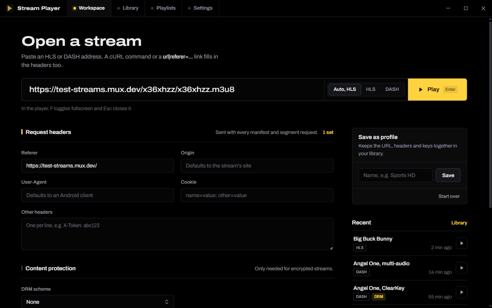
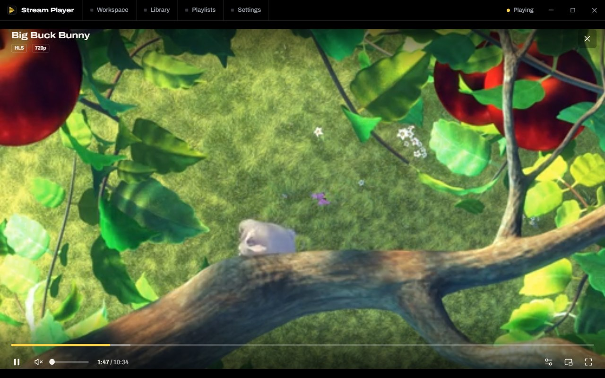
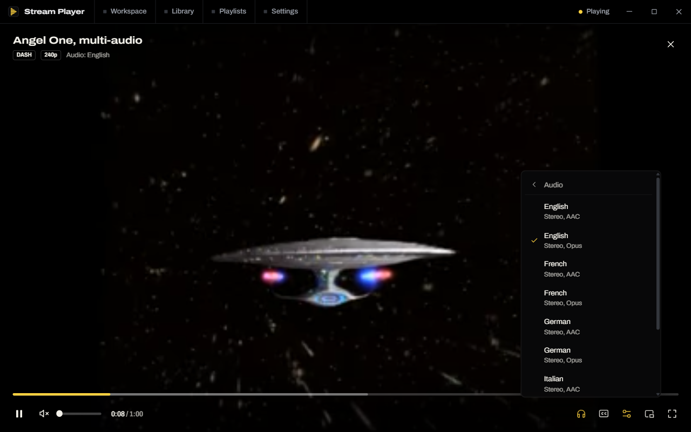
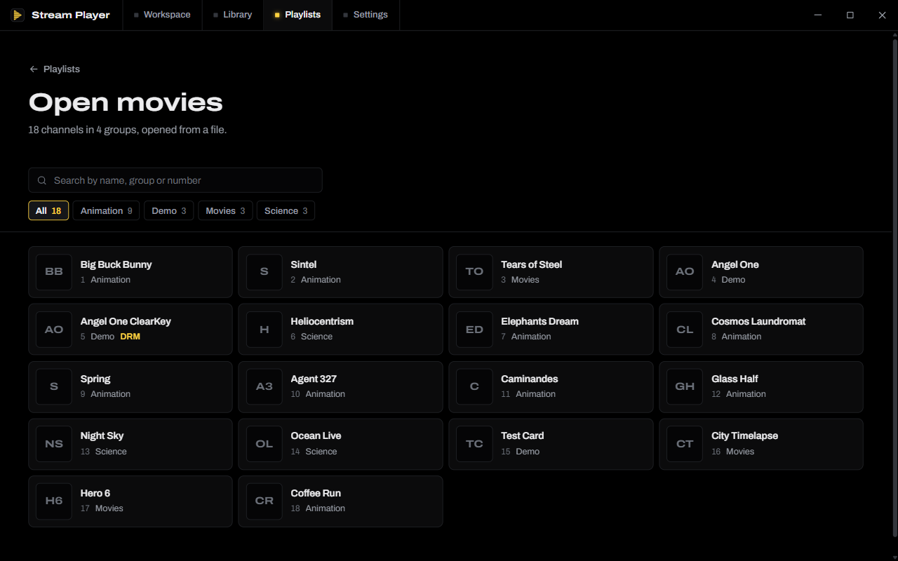
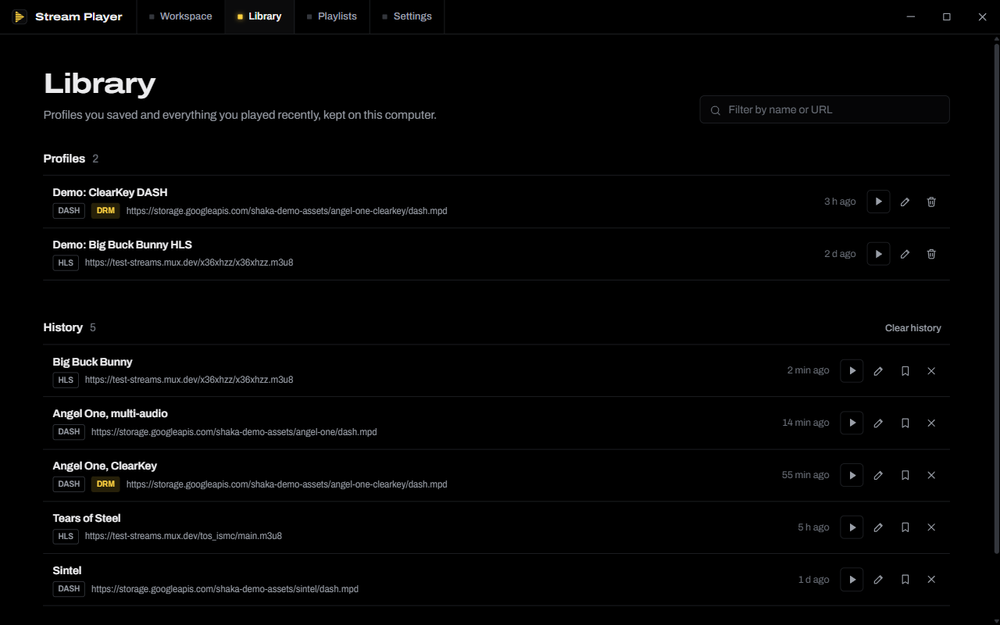
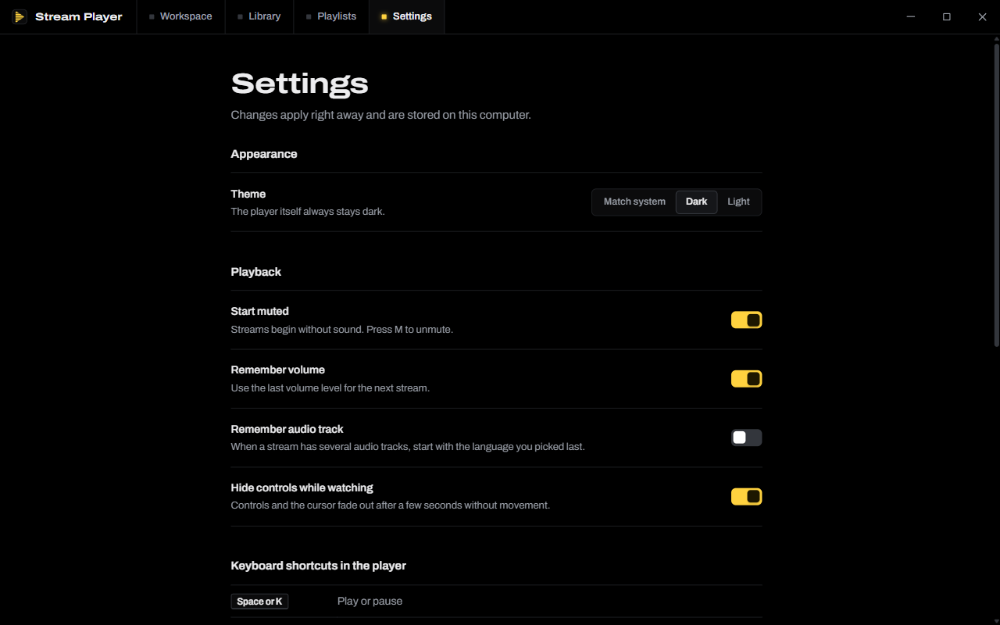
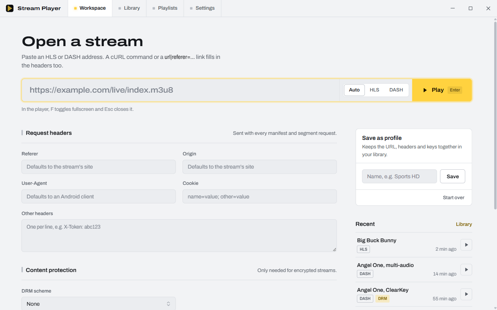

<p align="center">
  
</p>

# Stream Player

A Windows desktop player for HLS, DASH and IPTV playlists, with custom request headers and ClearKey / Widevine / PlayReady configuration. Built with Tauri 2, SvelteKit (Svelte 5) and Shaka Player.

> **Credits.** This is a rebuild of [**sirat-o/stream_player**](https://github.com/sirat-o/stream_player) by Sirat, which is itself a modified version of [**MirazMac/Media-Stream-Player**](https://github.com/MirazMac/Media-Stream-Player). The stream, header, DRM and M3U handling build on their work. This version adds a new interface, a rewritten player and the fixes listed below. Released under the original MIT license; see [LICENSE](LICENSE).

## Screenshots



| Player | Multiple audio tracks |
| --- | --- |
|  |  |
| **Playlist channels** | **Library** |
|  |  |
| **Settings** | **Light theme** |
|  |  |

<sub>Shown with public test streams from Mux and the Shaka Player demo assets.</sub>

## Download

Get `stream-player.exe` from the [latest release](../../releases/latest). It's a single standalone file, so there's nothing to install: put it anywhere and run it.

- Needs the Microsoft **WebView2 Runtime**. It's built into Windows 11 and most up-to-date Windows 10 PCs. If the app doesn't open, install the [Evergreen WebView2 Runtime](https://developer.microsoft.com/microsoft-edge/webview2/).
- The exe isn't code-signed, so Windows SmartScreen may warn on first run. Choose **More info → Run anyway**, or build it yourself (below).
- Your profiles, history, playlists and settings are stored in `%LOCALAPPDATA%\com.mas.player`, not in the exe, so replacing the exe keeps them.

## Build it yourself

### 1. Install the tools (once)

| Tool | Why | Get it |
| --- | --- | --- |
| **Node.js 20 or newer** (LTS) | Builds the interface | <https://nodejs.org> |
| **Rust** (stable, via rustup) | Builds the desktop app | <https://rustup.rs> |
| **Microsoft C++ Build Tools** | Rust needs the MSVC linker on Windows | [Visual Studio Build Tools](https://visualstudio.microsoft.com/visual-cpp-build-tools/), choose the **Desktop development with C++** workload |
| **WebView2 Runtime** | Renders the app | Already on Windows 11; see the link above for Windows 10 |
| **Git** | Gets the source | <https://git-scm.com> |

Tauri's [prerequisites guide](https://v2.tauri.app/start/prerequisites/) covers the same steps with screenshots.

### 2. Get the code and dependencies

```sh
git clone https://github.com/plum-blossom-cat/stream-player.git
cd stream-player
npm install
```

### 3. Run or build

```sh
npm run tauri dev                      # run the app with hot reload while you edit
npm run tauri build -- --no-bundle     # build the standalone exe
npm run tauri build                    # build installers (.msi and setup .exe)
```

| Command | Output |
| --- | --- |
| `npm run tauri build -- --no-bundle` | `src-tauri/target/release/stream-player.exe` |
| `npm run tauri build` | `src-tauri/target/release/bundle/msi/*.msi` and `src-tauri/target/release/bundle/nsis/*-setup.exe` |

The first build downloads and compiles the Rust dependencies and takes a few minutes. Later builds take well under a minute.

### Other useful commands

```sh
npm run dev                    # interface only, in a browser at http://localhost:1420
npm run check                  # type-check the Svelte code
npx tauri icon app-icon.svg    # regenerate every app icon after editing app-icon.svg
```

In a plain browser, Referer, Origin, Cookie and User-Agent headers can't be sent and servers must allow CORS. The desktop app routes requests through Rust, so neither limit applies there.

## What's new in this version

### Player
- **Fullscreen works properly.** The original player asked an element inside a transformed `<dialog>` to go fullscreen. Inside WebView2 that only fills the webview, so the app resized the window afterwards; the two raced, and the transparent shadowed window left a frame with rounded corners. Now the window itself goes fullscreen (shadow off first) and the player covers it. Browsers use the standard Fullscreen API. See `src/lib/player/fullscreen.js`.
- Esc leaves fullscreen first and only closes the player on the next press.
- New custom controls: seek bar with buffered range and hover time, live badge with "Go live", volume (mouse wheel works), quality, audio track, subtitles, speed, picture in picture and stream stats.
- **Multiple audio tracks.** Every audio track is listed separately: language, label, role, stereo or 5.1, and codec. Switch with the audio button or the A key. The app remembers your language for the next stream.
- Channel up / down while watching a playlist (N / P, Page Up / Page Down).
- Adaptive bitrate is on by default (the original locked streams to one quality).
- Errors explain what went wrong and offer Try again and Edit stream.

### Fixes
- Widevine / PlayReady certificate URLs were passed as raw bytes; they now use `serverCertificateUri`.
- Inline ClearKey accepted only one `kid:key` pair; several now work.
- URLs pasted with leading spaces failed with "unsupported scheme"; URLs are now cleaned on paste and before playing.
- Error text from servers was injected as raw HTML.
- The Tauri HTTP loader was registered for `blob:` URLs, which it can't fetch.
- The Rust and npm versions of the HTTP plugin were mismatched, which blocked `tauri build`.

### Interface
- New "instrument panel" design on true black (AMOLED), with a single yellow action colour, plus a light theme.
- Navigation lives in the custom title bar.
- Workspace: one large stream field that understands pasted cURL commands and `url|referer=…&drmScheme=clearkey&drmLicense=…` links, with headers, DRM and Shaka config below.
- Library: profiles and history together, with filter, edit, save-from-history and delete.
- Playlists: add by URL, open a file, or drop an `.m3u` onto the window. The channel browser has search, group filters and channel numbers, and handles large lists.

## Keyboard shortcuts in the player

| Key | Action |
| --- | --- |
| Space or K | Play or pause |
| F, F11 or double-click | Fullscreen |
| Esc | Leave fullscreen, then close |
| ← → | Back or forward 10 s |
| ↑ ↓ | Volume |
| M | Mute |
| A | Next audio track |
| C | Subtitles |
| N / P | Next or previous channel |
| I | Stream stats |

## Project layout

```
src/
  lib/
    player/
      engine.js            Shaka setup, headers, DRM, error messages
      fullscreen.js        Window or element fullscreen
      audio.js             Audio track naming and remembered choice
      player.svelte.js     Global player state and channel queue
    components/
      PlayerStage.svelte   Video, controls, menus, shortcuts
      TitleBar.svelte      Window chrome and navigation
      Logo.svelte          App mark
    stream.js              Stream model, validation, paste parsing, storage
    m3uParser.js           M3U / KODIPROP / EXTVLCOPT / EXTHTTP parsing (from the original project)
    TauriFetchLoader.js    Shaka network plugin over the Tauri HTTP client (from the original project)
  routes/                  Workspace, Library, Playlists, Settings
src-tauri/                 Rust shell and app icons
app-icon.svg               Source for every app icon
```

## License

MIT. The original copyright notice from [sirat-o/stream_player](https://github.com/sirat-o/stream_player) is kept in [LICENSE](LICENSE).
